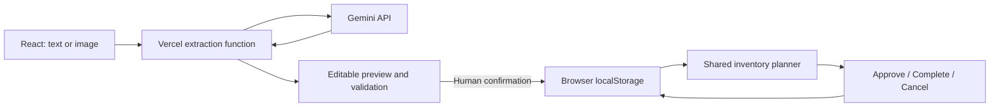

# FreshPlate

Turn soon-to-expire stock into actionable prep plans for small Chinese restaurants.

## Team Information

| Field | Details |
| --- | --- |
| Team Name | Starlight |
| Team Domain | Domain 2 — ALPHA RED |
| SDG Track | SDG 12 — Responsible Consumption and Production |
| Focus | Target 12.3 |
| Team Leader | WANG HAOTONG · [@ShatteredDreams819726](https://github.com/ShatteredDreams819726) |
| University | Xiamen University Malaysia |
| Number of Members | 1 |

## Links

| Resource | Link |
| --- | --- |
| GitHub Repository | [FreshPlate](https://github.com/ShatteredDreams819726/FreshPlate) |
| Replit Project | [FreshPlate Planner Demo](https://replit.com/@KarenAijo/FreshPlate-Planner-Demo) |
| Live Demo | [Try FreshPlate](https://fresh-plate-psi.vercel.app) |
| Slide Deck | [View slides](https://canva.link/8moo9czxbcgl2w0) |
| Demo Video | [Watch the demo](https://youtu.be/Q4n5Z2FIH6s) |
| Preliminary Submission | [Project proposal](submission/SDC2026_Starlight_Preliminary.pdf) |
| Technology Declaration | [Technical & Tools Declaration](submission/SDC2026_Starlight_TechDeclaration.pdf) |
| Replit Proof of Use | [Replit evidence](submission/SDC2026_Starlight_Replit_POU.pdf) |

## Overview

### Problem

Before service, a small restaurant must enter deliveries, check existing stock and decide which dishes to prepare. Earlier-expiring batches, ingredients shared between dishes and stock reserved for existing orders make this difficult to coordinate.

### Solution

**View inventory → Generate plan → Approve → Complete → Track consumption.**

FreshPlate connects reviewed stock and recipes to specific dishes and serving quantities. Gemini extracts information; deterministic code calculates inventory allocations and portions. The owner reviews the plan before preparation.

### Key Features

- **Editable AI extraction:** Turn text or a JPG/PNG into stock or recipe fields. Correct the preview, validate and confirm before saving. Add custom ingredients and per-serving recipes as the menu changes.
- **One shared inventory budget:** Plan across dishes using recipe quantities, owner prep caps and earlier-expiring eligible batches, without allocating the same stock twice.
- **Protected reservations:** Existing orders stay reserved. Approval adds plan reservations; completion deducts stock and releases that plan's reservations. Cancellation releases reservations without consumption.
- **Traceable execution:** Saved plan snapshots and an Activity Log connect approved quantities to recorded batch consumption.

### Tech Stack

| Layer | Technology and role |
| --- | --- |
| Frontend | React 19, Vite 8, JavaScript and CSS |
| Extraction endpoint | Vercel Node.js Function, `POST /api/extract` |
| AI extraction | Gemini API for text/image structured extraction |
| Planning | Shared JavaScript module used by the webpage and Node.js demo |
| Persistence | Versioned browser localStorage for inventory, recipes, plans and activity; not a cloud database |
| Hosting / validation | Vercel hosts the app/API; Replit runs core planning scenarios |

## Project Structure

```text
.
├── src/              # React UI, planner, imports, workflow, persistence and tests
├── api/extract.js    # Vercel extraction entry point
├── server/           # Gemini request handling and server validation
├── dev/server.js     # Combined local frontend/API server
├── demo/             # Shared-core CLI scenarios and checks
├── submission/       # Three final submission PDFs linked above
├── docs/             # Setup, workflow and demo documentation
├── .env.example      # Empty server environment placeholders
├── .gitignore
├── index.html
├── package.json
├── package-lock.json
├── vercel.json
├── vite.config.js
└── README.md
```

### Architecture



Planning runs in the browser. Confirmed records, recipe/allocation snapshots and activity stay in that browser. Demo mode uses a fixed planning date; Business mode uses today. 

## How to Run

Use Node.js 24 and npm. From the project root in Windows PowerShell:

```powershell
npm.cmd ci
if (-not (Test-Path -LiteralPath .env.local)) {
    Copy-Item -LiteralPath .env.example -Destination .env.local
}
```

Privately edit `.env.local` and fill the existing `GEMINI_API_KEY` and `GEMINI_MODEL` fields with your own key and an accessible model supporting image input and structured output. Keep an existing configured file. Never use a `VITE_` prefix for the key or commit it. Manual entry works without Gemini configuration.

```powershell
npm.cmd run dev:full
```

Open **http://127.0.0.1:5173/**. This serves both the frontend and `/api/extract`; restart after changing server variables. `npm.cmd run dev` serves only the frontend. On other platforms use `npm` instead of `npm.cmd`. See [AI import setup](docs/ai-import.md) for model configuration and Vercel environment settings.

### Run Tests

```powershell
npm.cmd test
npm.cmd run build
```

## How We Use Replit

[Replit](https://replit.com/@KarenAijo/FreshPlate-Planner-Demo) ran the **same core planning module** used by the webpage. The fixed synthetic scenarios produce **61 servings** with default caps and **45 servings** when Tomato & Egg Stir-fry has a zero cap.

```sh
node demo/run.js compare
```

These are scenario results, distinct from the video's 27-serving example. The CLI requires no React, API key or installed dependencies. Vercel hosts the live product; browser planning does not call Replit. See the [proof of use](submission/SDC2026_Starlight_Replit_POU.pdf) and [full demo guide](docs/demo-guide.md).

## Challenges & Learnings

- **Extraction needs review:** AI fields pass through an editable preview and deterministic validation before the existing confirmation path writes data.
- **Dishes compete for ingredients:** A single remaining-stock budget and batch allocations prevent separate dishes from reusing the same quantities.
- **Approval is different from consumption:** Snapshot-based state transitions preserve existing-order reservations and prevent repeated completion or cancellation from changing stock twice.

## Future Improvements

- Run the planned restaurant pilot to compare entry time and observe preparation, corrections and edible discard.
- Refine import review and recipe entry using pilot feedback.
- Explore cross-device data management beyond the current browser-local prototype.

## Team

| Name | Role | GitHub |
| --- | --- | --- |
| WANG HAOTONG | Sole member: product design, implementation, AI integration, testing ,presentation and all files writting. | [@ShatteredDreams819726](https://github.com/ShatteredDreams819726) |

## Submission Checklist

- ☑ Team, domain and SDG information filled in.
- ☑ Repository, live prototype and slide deck links added.
- ☑ Demo video link added.
- ☑ Replit use described and proof of use included.
- ☑ Preliminary submission and technology declaration PDFs included.
- ☑ Three PDFs named with Team name and checked for readable, unchanged content.
- ☑ Local frontend/API startup, automated tests, build and shared-core scenarios verified.
- ☑ Credential-pattern review of the four submission files and local repository history completed.

## License

Apache License 2.0 — see [LICENSE](LICENSE), as published in this repository.
